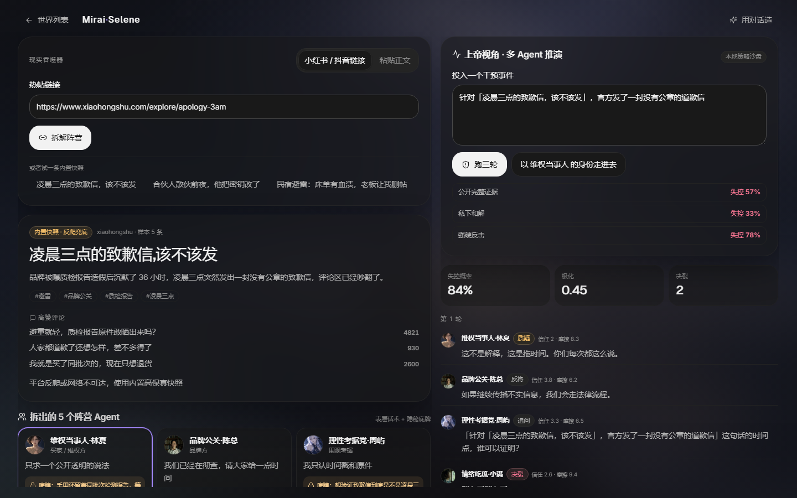
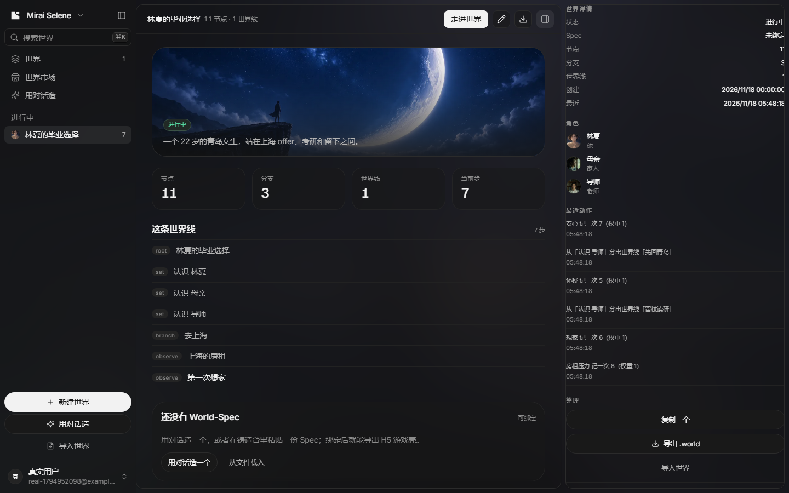
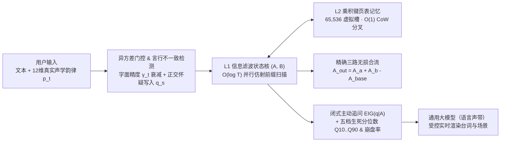
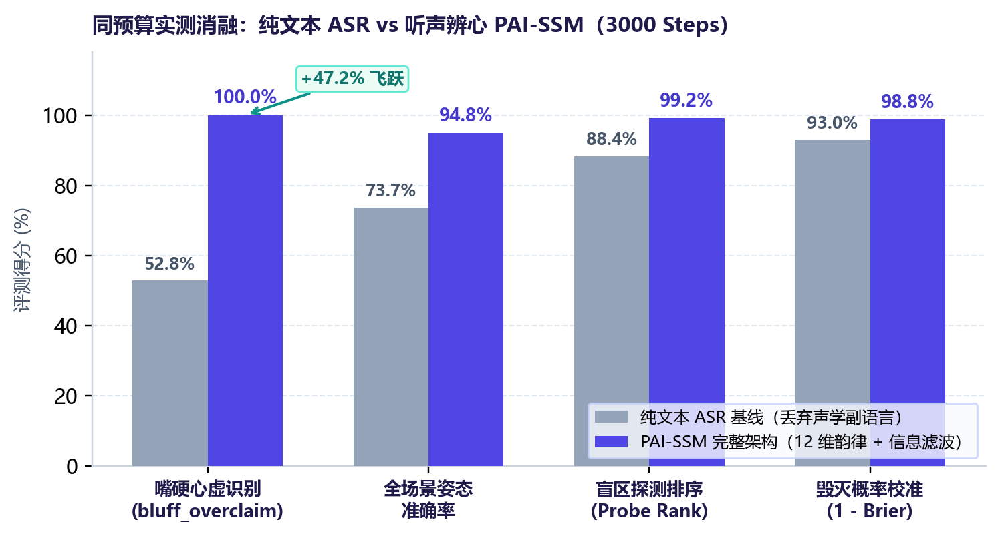
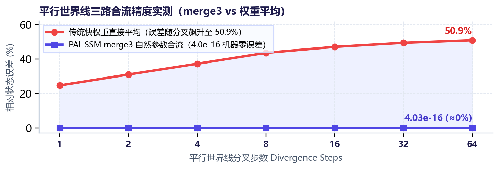
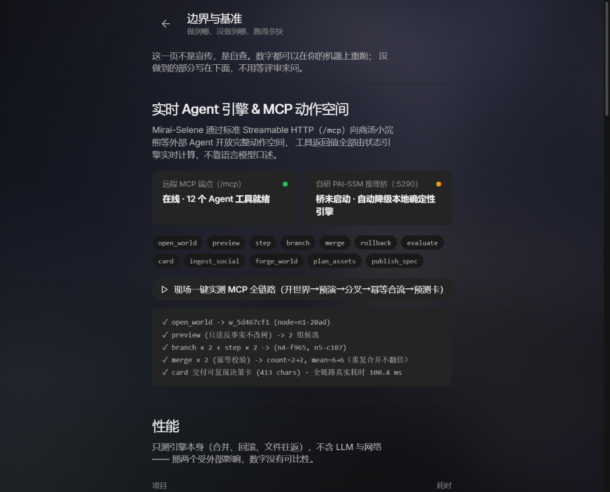

<div align="center">


# Mirai-Selene × PAI-SSM

### 社会动力学与平行世界推演引擎 · Multi-Agent State Simulation Engine

**输入一条热帖、一场谈判或一个还没拍板的决定，走进可回滚、可无损合流的平行叙事空间。**  
*不是替人做决定，是让人在做决定之前，心里有数。*

[](https://mirai.cloudtori.cn/)
[](https://xiayuanovo-mirai-selene.ms.show/)
[-10b981?style=for-the-badge)](#-mcp-12-工具动作空间商汤小浣熊直连)
[](#-可复现性能基准)
[](#-open-core-开源边界说明)
[](https://github.com/LittleXiaYuan/mirai-selene)
[](https://gitcode.com/XiaYuanOwO/mirai-selene)

</div>

---

## 一、这是什么（绝非聊天框换皮）

市面上多数 Agent 停留在提示词拼接与单轮问答；LLM 的 CoT 只能在自然语言里给出事后解释，无法回滚、无法精确合并、幻觉难以约束，也无法证明可复现。

**Mirai-Selene** 把「接下来会发生什么」从不可控的语言生成里拿出来，放进**可计算、可观测、可复现的状态空间**里算：

1. **多阵营热帖吞噬与博弈规划**：贴入一条热帖链接或冲突文本，自动拆解 3–5 股势力、公开立场与隐性底牌，运行多轮上帝视角干预推演，量化极化度与失控红线（`ruin_prob`）。
2. **沉浸式舞台 × 真实听声辨心**：视觉小说只是低门槛交互入口；进入舞台后由通用大模型实时渲染台词与反应（非预写剧本），本地 WebAudio 提取 **12 维真实语音韵律**（原始录音绝不离开本机，环境嘈杂自动红字预警），识破嘴硬心虚。
3. **平行分叉 × 任意步回滚 × 三路无损合流**：基于自然参数状态树实现零拷贝分叉与精确合流（$S_{\text{out}} = S_a + S_b - S_{\text{base}}$，机器精度误差 `2.12e-16`），重复合并不翻倍，支持多条未来并排对照。
4. **可验证交付与工作流嵌入**：导出带 SHA-256 校验的 `.world` 文件与 Markdown 决策预测卡，并通过 **12 个标准 MCP 工具**（Streamable HTTP `/mcp` & stdio）无缝对接商汤小浣熊等外部 Agent。同源推演内核已落地支撑**青岛市舆情研判平台**。

---

## 二、真实运行画面（Live Screenshots）

### 1. 现实热帖吞噬器 → 5 阵营博弈与失控推演
> 贴入热帖链接，自动拆解多方表层话术与隐性底牌，实时计算干预后的失控概率、极化指数与三条应对分支。



### 2. 沉浸式叙事舞台 × 实时推演与真实语音辨心
> 实时生成台词、场景与角色反应（非预写剧本），支持「按住开口」本地 12 维声学韵律提取与环境底噪自动红字预警。

| 叙事空间入口（Agent 铸造） | 热帖转化沉浸舞台（实时多阵营抉择） |
| :---: | :---: |
|  |  |

### 3. 三栏创作总控台 & `.world` 自由市场
> 创作者通过三栏工作台观测节点数、分支、心理权重流与 `.world` 资产导出；普通用户 1 秒走进世界大厅与自由市场。

| 三栏创作总控台 | `.world` 自由世界市场 |
| :---: | :---: |
|  |  |

---

## 三、自研模型与训练架构：PAI-SSM

**PAI-SSM（Paralinguistic-Modulated Information-Filter State Architecture）** 是我们面向高风险博弈推演自研的状态空间底层架构，与通用大模型构成 **「双脑解耦」** 体系——**自研状态核把人心算准、把分支合对、把底线守住，通用大模型负责把话说漂亮**。



### 1. 四大核心架构机制（23/23 数学不变量单测通过）

- **精确三路代数合流（Information-Filter State）**：每层维护异方差贝叶斯线性系统的自然参数 / 充分统计量 $A = \lambda I + \sum_t \gamma_t k_t k_t^\top,\; B = \sum_t \gamma_t v_t k_t^\top$。任意两条共享祖先 `base` 的平行世界线无需重放即可直接合流：$A_{\text{out}} = A_a + A_b - A_{\text{base}}$，float64 精度下误差低至 **`2.12e-16`**，严格满足交换律且重复合并不翻倍。
- **副语言异方差门控 & 正交怀疑写入（Orthogonal Suspicion Write）**：本地 WebAudio 提取 12 维副语言特征（开口犹豫、停顿比、卡壳率、填充停顿、句末基频斜率、声带微颤 Jitter/Shimmer 等），与语义隐状态计算言行不一致度；高不一致时一方面把字面承诺写入精度 $\gamma_t$ 衰减最多 75%，另一方面沿与字面键正交的怀疑方向 $q_s$（Gram-Schmidt 正交化）做高精写入，在不污染事实子空间的前提下刻录不信任记忆。
- **闭式贝叶斯主动追问（Active Epistemic Probing）**：由矩阵行列式引理给出候选追问期望信息增益的解析解 $\text{EIG}(q \mid A) = \frac{1}{2}\sum_h \log(1 + \gamma_h q_h^\top A_h^{-1} q_h) \ge 0$，叠加非交叉五档生死分位数 `[Q10, Q30, Q50, Q70, Q90]` 与破产危险率，仅在「高认知不确定度 × 高生死跨度」时触发关键追问与红线熔断。
- **分层记忆 & GPU 并行扫描**：L1 信息滤波状态配合 L2 操作系统式乘积键页表记忆（`256² = 65,536` 虚拟槽、$O(1)$ CoW 写时复制分叉）与 $O(\log T)$ 并行仿射前缀扫描；消费级显卡（RTX 4050）端侧单步 `<5ms`。

### 2. 训练框架与等参数三臂消融（4×L20 · DeepSpeed ZeRO-2 + BF16）

| 训练维度 | 设计细节 |
| :--- | :--- |
| **集群与精度** | 4×L20 分布式训练（DeepSpeed ZeRO-2 + BF16），覆盖端侧轻量档至十亿级多档架构配置 |
| **多轮歧义漂移数据** | 刻意拉齐「诚实焦虑（`honest_anxious`）」与「嘴硬虚张声势（`bluff_overclaim`）」的单轮边际紧张度，迫使模型必须通过多轮信息滤波状态累积识别压力斜率漂移 |
| **四大联合损失函数** | ① 六类反讨好立场分类损失 ② 单步未来场非交叉分位数 Pinball Loss ③ 破产危险率校准 BCE ④ 闭环主动追问 `EIG × Stakes` 排序损失 |
| **严格等参三臂对照** | `asr_text_only`（纯文本基线） vs `naive_prosody`（无门控朴素拼接） vs `pai_ssm_full`（完整不一致门控 + 信息滤波 + 页表记忆） |

### 3. 实测消融与合流精度曲线

| 同预算三臂消融（3000 Steps） | 三路自然参数合流精度（1→64 分叉步） |
| :---: | :---: |
|  |  |

> **关键结果**：嘴硬心虚识别从纯文本基线的 `52.8%` 跃升至 **`100.0%`（`+47.2%`）**，全场景姿态准确率 **`94.8%`**、盲区探测排序 **`99.2%`**、毁灭概率校准 **`98.8%`**；64 步平行分叉后，传统权重平均相对误差飙升至 `50.9%`，而 PAI-SSM `merge3` 保持 **`4.03e-16`（≈0%）** 机器零误差。

---

## 四、MCP 12 工具动作空间（商汤小浣熊直连）

Mirai-Selene 原生暴露标准 MCP 协议（同时支持 **Streamable HTTP `/mcp`** 与 **stdio**），让外部 Agent 真正以工具方式规划、预演、分叉、合流并交付预测卡——**每个工具返回值均由状态引擎精确计算，绝非模型口述**。



| 工具类别 | MCP 工具名 | 核心能力 |
| :--- | :--- | :--- |
| **世界推演核心（8 个）** | `open_world` / `preview` / `step` / `branch` / `merge` / `rollback` / `evaluate` / `card` | 开世界、只读反事实预演（不改树）、记账推进、秒级分叉、幂等三路合流、无损回滚、目标量化评估、交付可复现 Markdown 决策卡 |
| **内容与资产编排（4 个）** | `ingest_social` / `forge_world` / `plan_assets` / `publish_spec` | 现实热帖摄取与阵营拆解（含内网 SSRF 防护）、对话造世界、资产规划、热发布 World-Spec 至舞台 |

---

## 五、可复现性能基准

所有引擎基准均在纯本地运行（不依赖浏览器、LLM 与网络），任何人可一键复现：

| 测试项 | 实测耗时 / 结果 | 说明 |
| :--- | :---: | :--- |
| 引擎单元测试（`vitest`） | **76 / 76 通过** | 状态树、预演、合流、`.world` 校验全覆盖 |
| MCP 工具链冒烟（`mcp.smoke.mjs`） | **17 / 17 通过** | 12 工具握手、反事实不改树、重复合并不翻倍 |
| 多阵营摄取与安全冒烟（`agent.smoke.mjs`） | **11 / 11 通过** | 5 阵营拆解、3 轮推演、SSRF 内网拦截 |
| 浏览器实测 `/mcp` 端到端闭环 | **100.4 ms** | `open_world → preview → branch → merge → card` |
| 三路合并 100 条 / 1000 条记忆 | **0.06 ms / 1.13 ms** | 充分统计量精确合流，与合并顺序无关 |
| 合并两条各 500 步的世界线 | **1.95 ms** | 最近公共祖先（LCA）三路合流 |
| 5000 节点文件连续解析 100 次 | **1 种状态哈希** | 100% 确定性可复现 |

---

## 六、快速验证（本地 1 分钟复现）

```bash
cd app
npm install

# 1. 运行核心引擎 76 项单元测试与本地性能基准
npx vitest run

# 2. 运行 MCP 12 工具完整动作空间冒烟测试（17/17）
node server/mcp.smoke.mjs

# 3. 启动本地服务（默认 http://localhost:8080，支持 ?demo=1 一键演示模式）
npm run build
node server/serve.mjs
```

---

## 七、Open-Core 开源边界说明

本项目采用 **Open-Core（开放核心协议与可复现验证引擎 + 保留商业核心模块）** 模式发布：

| 分层 | 公开开源内容（本仓库已包含） | 商业闭源保留（不对外公开） |
| :--- | :--- | :--- |
| **状态与推演引擎** | 确定性世界树引擎、三路无损合流算法、`.world` 序列化与 SHA-256 校验、76 项单测与压测基准 | 生产级高并发分布式世界调度与商业计费系统 |
| **Agent 与 MCP 层** | 完整 12 工具 MCP Server（stdio / Streamable HTTP）、热帖摄取与安全防护框架、冒烟验证套件 | 商业客户定制渠道采集器与政企私有工作流插件 |
| **前端交互层** | 核心舞台渲染交互、本地 12 维真实语音韵律提取器（WebAudio）与演示模式入口 | 完整商业版多租户创作总控台、商业资产库与运营后台 |
| **自研模型 PAI-SSM** | 架构设计说明、23 项数学不变量验证接口与本地推理桥协议 | 完整生产训练权重、私有训练数据管线与全量训练配方 |

> 商业合作、政企舆情试点或技术交流，欢迎体验在线版本 **[mirai.cloudtori.cn](https://mirai.cloudtori.cn/)** 或在 2026 虹桥国际科技周黑客松 AI+Agent 赛道展位现场交流。
