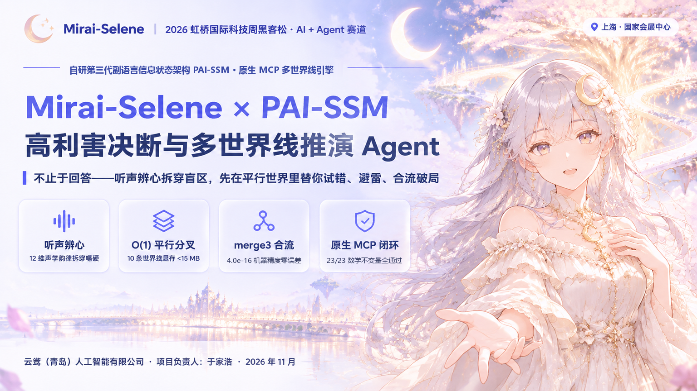
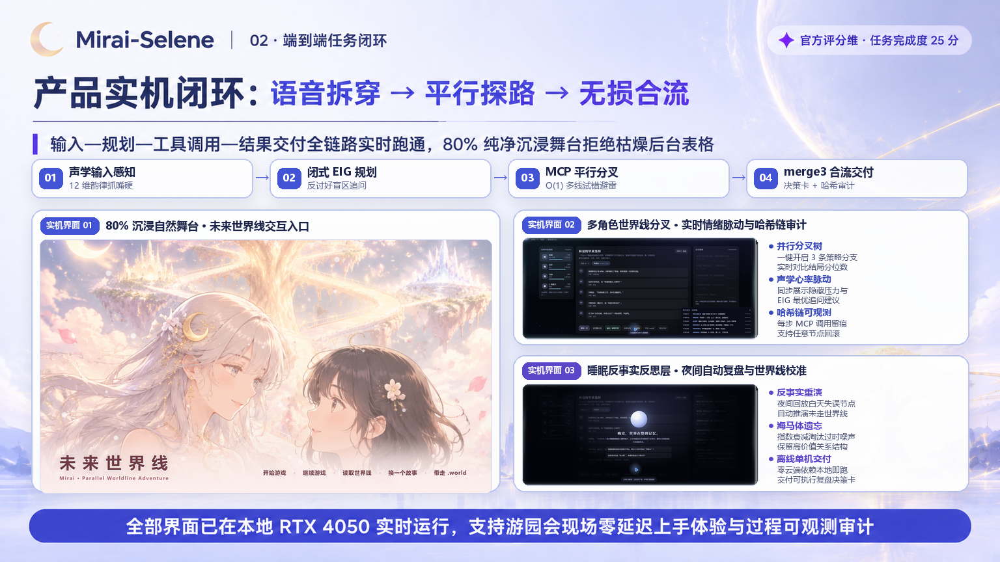
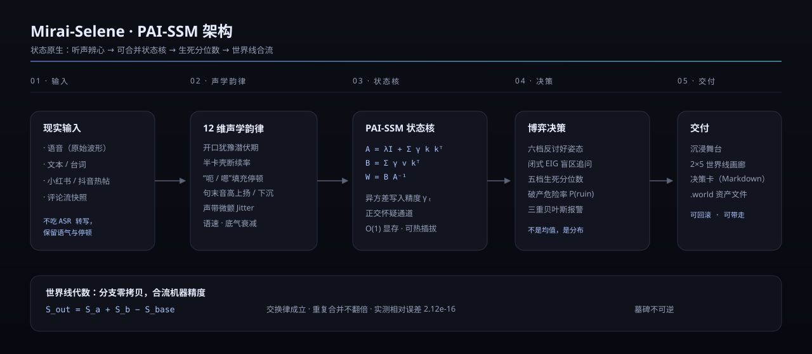
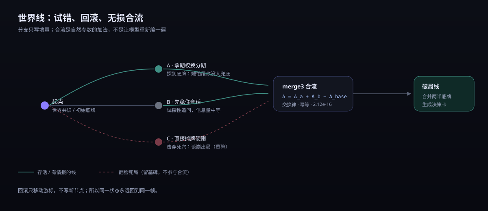

# Mirai-Selene

**听得出你在心虚，算得清这一步的生死边界。**

[](https://xiayuanovo-mirai-selene.ms.show)
[](epistemic_model/test_invariants.py)
[](LICENSE)



---

## 先说痛点：现有 AI 在关键时刻，三件事全错

假设你明天要谈一场硬仗——合伙人要散伙、客户在压价、你准备实名举报。
你打开一个通用大模型，它给你三段正确的废话。问题不在它不聪明，而在结构上做不到：

**1. 文字抹平了情绪。**
你说“我不怕他报复”，语音转文字之后是七个字；可你说话时停顿了 1.2 秒、尾音上扬、声带在抖。
ASR 一转换，这些信号全被销毁。模型只能把你当“嘴硬的正常人”来安慰。

**2. 单线试错，试完不能合流。**
你想同时看看“硬刚”和“先稳住”两条路。传统做法是开两个会话，各聊各的；
想把两条路探到的底牌合起来？只能让模型写一段摘要——有损，还容易编。

**3. 用平均值掩盖死局。**
一边是 +9 一战成名，一边是 −9 身败名裂。均值是 0。
可现实里没有“0”这个结局。你真正要知道的是：**最坏能坏到哪、哪一步不可逆。**

所以这个项目不从“再套一层 Prompt”开始，而是从**状态怎么表示**开始重做。

---

## 我们做了什么：四个动词

| 动词 | 具体是什么 |
|---|---|
| **造** | 一句话，或一条小红书/抖音热帖，自动拆出 3–5 个阵营：表层话术、隐秘底牌、死穴阈值 |
| **走** | 视觉小说式舞台，一次一个选择；按住说话，12 维声学韵律直接参与判断 |
| **悔** | 分叉、回滚、合并。分支零拷贝，合流是代数加法，不是重新生成 |
| **带** | 世界是一个带校验的 `.world` 文件，能导出、能载入、能校验 |

---

## 实机

### 一条热帖，拆出五个阵营，算清失控率


> 导入热帖 → 抓正文与高赞评论 → 揣测各方潜台词 → 5 个阵营 Agent 互相博弈三轮
> → 输出整体失控率、极化指数，以及三条公关分支的失控对比（示例：57% / 33% / 78%）。

### 选一个身份，走进沉浸舞台


> 没有侧边栏、没有仪表盘。80% 的画面留给场景与立绘，底部一层渐变台词框。
> 后台趁你阅读时预渲染下一幕分镜，切图不等待。

### 世界线画廊：分叉、探路、无损合流


> 每条世界线有独立游标与记忆；两条存活分支可以合流成新的破局线，谈崩的分支留墓碑、不参与合并。



---

## 底层：PAI-SSM

**不是给大模型套壳，而是自己实现状态怎么存、怎么写、怎么合。**



| 机制 | 一句话 |
|---|---|
| **可合并快权重 `W_fast`** | 存自然参数 `A = λI + Σγkkᵀ`、`B = Σγvkᵀ`；改的是突触，不是聊天记录；支持热插拔与精确遗忘 |
| **副语言异方差门控** | 12 维声学韵律算出“言行不一致度”；越心虚，字面写入精度 γₜ 越低，怀疑刻进正交子空间 |
| **单步未来场** | 不逐词自回归，一次并行投影未来 8 步的五档分位数与破产危险率 |
| **利害加权 EIG 追问** | 只在“既没摸清底牌、又关乎生死”的方向上主动发问，不无病呻吟 |
| **CoW 虚拟页表** | GPU 只驻留 `O(1)` 状态核；百万级历史细节放 L2 页表，指针寻址，分支零拷贝 |

核心不变量：

```text
S_out = S_a + S_b − S_base
```

交换律成立、重复合并不翻倍、实测相对误差 **2.12e-16**。



---

## 实测（合成评测集）

| 指标 | 结果 | 说明 |
|---|---|---|
| 高压姿态 / 嘴硬拆穿 | **100.0%** | 同预算三臂消融；纯文本 ASR 基线 52.8%–80.1% |
| 破产风险 Brier | **0.0002** | 纯文本基线 0.0677 |
| 五档分位数交叉 | **0 次** | `[Q10, Q30, Q50, Q70, Q90]` 严格不交叉 |
| `merge3` vs 全量重放 | **2.12e-16** | 每 500 步校验；64 步时传统权重平均误差约 50.9% |
| 数学不变量 | **23 / 23** | `epistemic_model/test_invariants.py` |
| 世界树单测 | **66 / 66** | `app/src/world/*.test.ts` |
| 端侧推理 | **< 5 ms/步** | RTX 4050 Laptop，10 条世界线显存 < 15 MB |


> 诚实边界：以上数字来自**合成博弈与声学韵律数据**。真实录音与真实语料上的表现
> 需要进一步微调与评测；我们没有把合成结果说成真实场景能力。

---

## 快速开始

### 1. 前端 + 服务端

```bash
cd app
npm install
npm run build
node server/serve.mjs        # http://127.0.0.1:8080
```

前端开发模式（另开一个终端，API 走 8080）：

```bash
cd app
npm run dev                  # http://127.0.0.1:5274
```

### 2. 模型与不变量测试

```bash
pip install torch numpy
python -m epistemic_model.test_invariants
```

冒烟训练（CPU 可跑，几十秒）：

```bash
python -m epistemic_model.train_l20 --preset smoke --steps 80 --ablation
```

### 3. MCP（给 Agent 用）

```bash
cd app
npm run build:mcp
npm run test:mcp
```

暴露 `open_world → preview → branch → step → evaluate → merge → rollback → card`
以及情摄取工具，stdio 与 Streamable HTTP（`/mcp`）双模。

### 4. 在线 Demo

- 引擎单句推演：<https://xiayuanovo-mirai-selene.ms.show>
- 完整产品：<https://mirai.cloudtori.cn>

---

## 仓库结构

```text
open-source/
├── app/                  # React 19 + Vite 前端 / Node 服务端 / MCP
│   ├── src/              # 界面、世界树、声学韵律、舞台
│   ├── server/           # 认证、世界数据、舆情摄取、MCP、SMTP
│   └── public/mirai/     # 界面使用的立绘与场景图
├── epistemic_model/      # PAI-SSM：架构、韵律、未来场、分页内存、训练与测试
├── deploy/               # 部署与浏览器验收脚本
├── docs/                 # 设计、世界线引擎、部署、比赛材料
├── assets/               # README 截图与自绘架构图
├── LICENSE               # 代码：MIT
├── WEIGHTS.md            # 权重与美术素材的单独授权
└── NOTICE.md             # 包含 / 不包含清单
```

---

## 半开源边界

- **开放**：应用代码、模型实现、训练与测试脚本、部署脚本、文档
- **不开放**：模型权重（走 ModelScope）、比赛 PPT/宣传片/海报、`components.json` 里的 registry key、任何 `.env`
- 权重**研究与评测免费，商用需书面授权**；细节见 [`WEIGHTS.md`](WEIGHTS.md)

## 配图说明（给设计同学）

README 中的位图都在 `assets/`，替换时保持文件名即可：
`hero.png`、`social-sandbox.png`、`vn-stage.png`、`market.png`、`product-flow.png`、
`chart-ablation.png`、`chart-merge3.png`。
架构图与世界线图是自绘 SVG：`architecture.svg`、`worldline.svg`，可直接改文字与配色。

## License

代码 MIT。权重与美术素材另行授权。见 [`LICENSE`](LICENSE)、[`WEIGHTS.md`](WEIGHTS.md)。

## 联系

- 邮箱：hi@cloudtori.cn
- 主体：云鸢（青岛）人工智能有限公司
